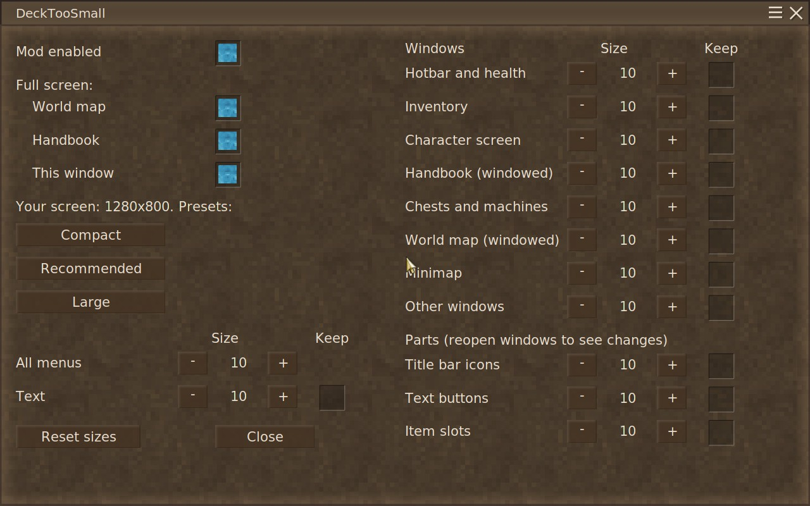
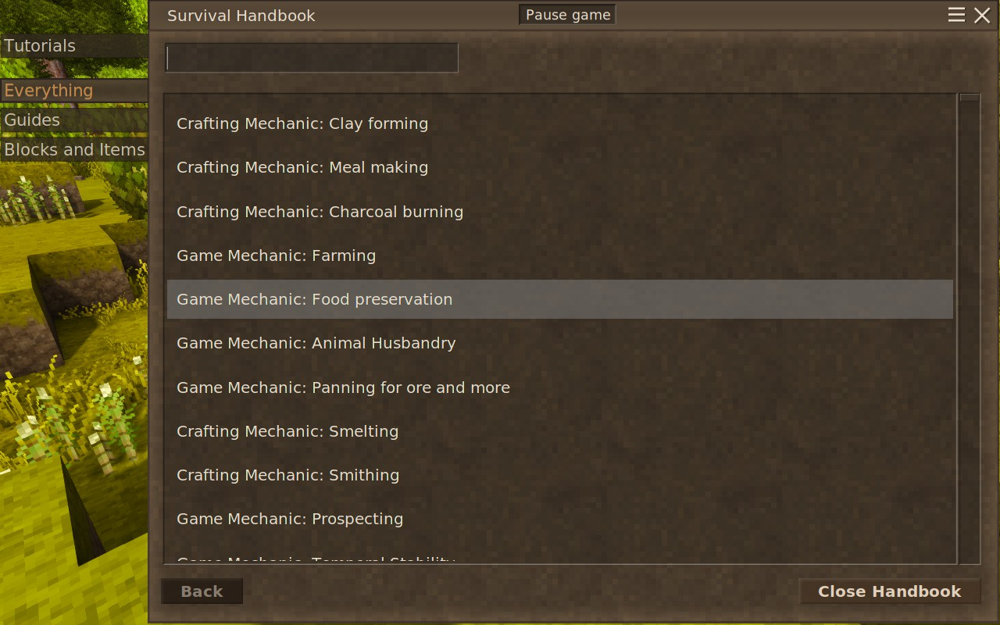
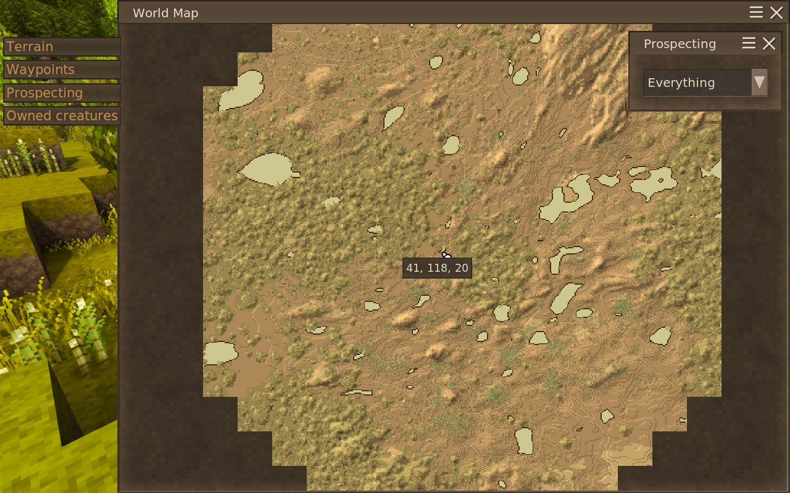
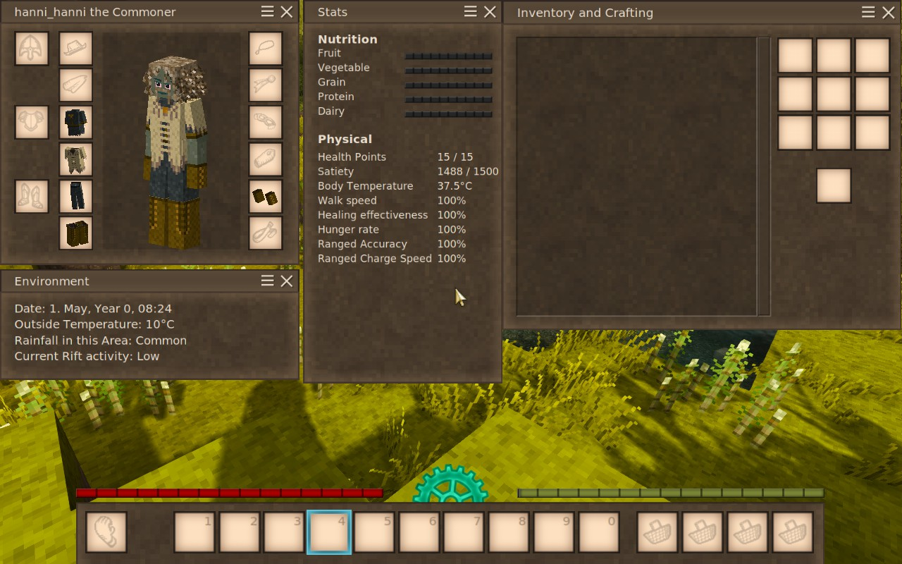
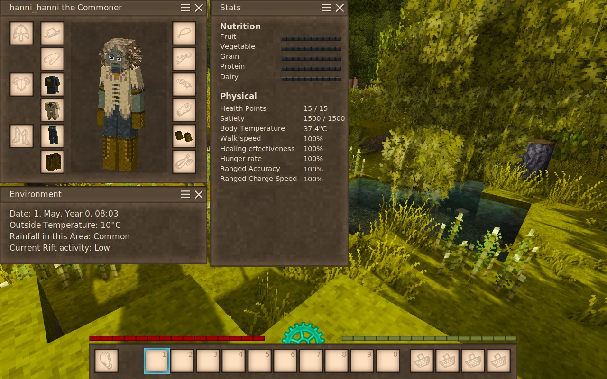
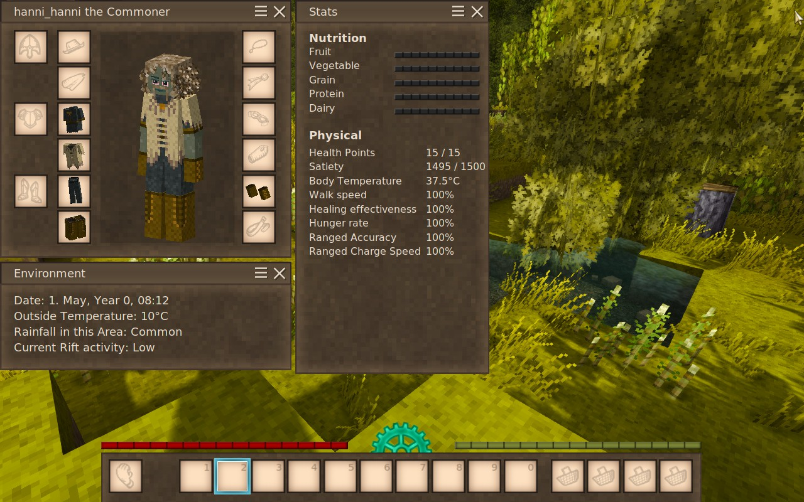
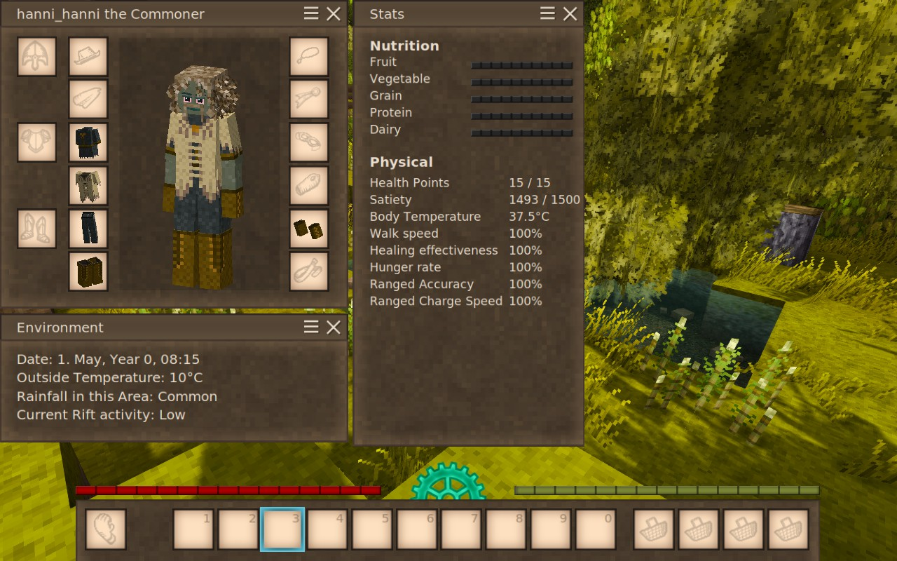

# DeckTooSmall

A client-side Vintage Story mod that makes the menus usable on the Steam Deck's
1280x800 screen. Built for game version 1.22.

By HanniHanni.

## Screenshots

Taken on a 1280x800 screen. Click one to see it full size.

<table>
<tr>
<td align="center" width="50%"> Settings window (F9)</td>
<td align="center" width="50%"> Full-screen Handbook</td>
</tr>
<tr>
<td align="center" width="50%"> Full-screen world map</td>
<td align="center" width="50%"> Character screen and inventory</td>
</tr>
</table>

The character screen at three sizes:

<table>
<tr>
<td align="center" width="33%"> Size 1</td>
<td align="center" width="33%"> Size 2</td>
<td align="center" width="33%"> Size 3</td>
</tr>
</table>

## Using it

- **F7 / F8**: smaller / bigger UI
- Picks a starting size from your screen resolution and remembers your choice per screen
- Full-screen world map, Handbook and settings window, and a minimap size setting
- **F9**: settings window (turn the mod on or off, sizes per window and per part)
- `.dts help` in chat: the same settings as commands

Keys and commands: [short version](docs/keys-and-commands-short.md) or [full list](docs/keys-and-commands.md).

## Building

Needs the .NET 10 SDK, and `VINTAGE_STORY` set to the game's install folder.
Run `./build.sh`; the mod zip appears in `Releases/`.

## Old versions

| Version | What is kept | Notes |
|---|---|---|
| 1.1.0 | source file only, `archive/v1/` | First attempt: bigger text only |
| 2.0.0 | built zip | Shrinks any window that does not fit the screen |
| 2.0.1 | built zip | Own UI size, windows pinned top left |
| 2.0.2 | built zip | F7 / F8 to change the size |
| 2.0.5 | built zip | Fits windows to the screen, top left, own UI size |
| 2.1.0 | built zip | Settings window, per-window sizes, text size, chat commands |
| 2.2.1 | built zip, source at tag `v2.2.1` | Title bar, button and slot sizes |
| 2.2.2 | built zip | Screen presets, per-screen size, 0.5 / 0.1 steps |
| 2.2.3 | built zip, source at tag `v2.2.3` | Character screen panels stay snug |
| 2.2.4 | built zip | Preset buttons no longer overlap |
| 2.2.5 | built zip | Full-screen map, Handbook and settings; minimap size |
| 2.2.6 | built zip | Full screen is optional; author name. Has the item-dropping bug fixed in 2.2.7 |
| 2.2.7 | built zip and the source in this repository | Fixes items being thrown when clicking some slots (not yet tested) |

Versions 2.0.3, 2.0.4 and 2.2.0 were not kept.
